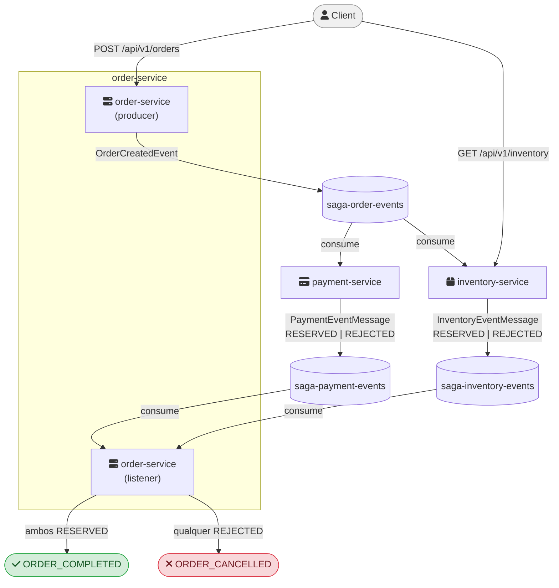

# SAGA Choreography v2 — Clean Architecture + DDD

Sistema de microsserviços Java 21 / Spring Boot 3.3.5 implementando o padrão **SAGA Choreography** com **Clean Architecture**, **Domain-Driven Design (DDD)**, **SOLID** e **GRASP**.

---

## Índice

1. [Visão Geral](#1-visão-geral)
2. [Arquitetura](#2-arquitetura)
   - [As Quatro Camadas (Uncle Bob)](#21-as-quatro-camadas-uncle-bob)
   - [Mapeamento no Projeto](#22-mapeamento-no-projeto)
   - [A Regra de Dependência](#23-a-regra-de-dependência)
   - [Fluxo SAGA Choreography](#24-fluxo-saga-choreography)
3. [Módulos Maven](#3-módulos-maven)
4. [Stack Tecnológica](#4-stack-tecnológica)
5. [Pré-requisitos](#5-pré-requisitos)
6. [Executando Localmente](#6-executando-localmente)
7. [Endpoints e Documentação API](#7-endpoints-e-documentação-api)
8. [Kafka — Tópicos e Mensagens](#8-kafka--tópicos-e-mensagens)
9. [Banco de Dados](#9-banco-de-dados)
10. [Monitoramento e Observabilidade](#10-monitoramento-e-observabilidade)
11. [Testes](#11-testes)
12. [Testes de Performance](#12-testes-de-performance)
13. [Kubernetes e API Gateway](#13-kubernetes-e-api-gateway)
14. [Qualidade de Código](#14-qualidade-de-código)
15. [Variáveis de Ambiente](#15-variáveis-de-ambiente)
16. [Decisões de Design](#16-decisões-de-design)

---

## 1. Visão Geral

Os serviços comunicam-se exclusivamente via **eventos Kafka**, sem orquestrador central. Cada serviço reage a eventos de outros serviços e publica seus próprios eventos, garantindo consistência eventual distribuída.



---

## 2. Arquitetura

### 2.1 As Quatro Camadas (Uncle Bob)

> *"The overriding rule that makes this architecture work is The Dependency Rule: source code dependencies can only point inwards."*
> — Robert C. Martin, [The Clean Architecture (2012)](https://blog.cleancoder.com/uncle-bob/2012/08/13/the-clean-architecture.html)

```
╔══════════════════════════════════════════════════════════════╗
║  4. Frameworks & Drivers                                     ║
║  ┌────────────────────────────────────────────────────────┐  ║
║  │  3. Interface Adapters                                 │  ║
║  │  ┌──────────────────────────────────────────────────┐  │  ║
║  │  │  2. Use Cases (Application Business Rules)       │  │  ║
║  │  │  ┌────────────────────────────────────────────┐  │  │  ║
║  │  │  │  1. Entities (Enterprise Business Rules)   │  │  │  ║
║  │  │  └────────────────────────────────────────────┘  │  │  ║
║  │  └──────────────────────────────────────────────────┘  │  ║
║  └────────────────────────────────────────────────────────┘  ║
╚══════════════════════════════════════════════════════════════╝
         Dependências sempre apontam para o centro →
```

| Camada | Responsabilidade | O que NÃO pode entrar |
|--------|-----------------|----------------------|
| **1 — Entities** | Regras de negócio da empresa. Os objetos mais estáveis do sistema. | Spring, JPA, Kafka, banco de dados, qualquer framework |
| **2 — Use Cases** | Regras de negócio da aplicação. Orquestra o fluxo entre entidades. | Infrastructure, banco de dados, Kafka, REST |
| **3 — Interface Adapters** | Converte dados entre o formato interno (domínio/use cases) e o externo (HTTP, BD, eventos). | Lógica de negócio |
| **4 — Frameworks & Drivers** | Web, banco de dados, Kafka, Spring Boot. "The Web is a detail." | — (camada mais externa) |

### 2.2 Mapeamento no Projeto

Cada serviço implementa as quatro camadas como módulos Maven independentes:

```
{service}-service/
│
├── {service}-domain/
│   ├── {service}-domain-core/          ← Camada 1: ENTITIES
│   │   Aggregates, Value Objects, Domain Events,
│   │   Domain Services — zero dependências de framework
│   │
│   └── {service}-application-service/  ← Camada 2: USE CASES
│       Command Handlers, Input/Output Ports (interfaces),
│       DTOs, Mappers, Métricas de negócio (SagaMetrics)
│
├── {service}-infrastructure/           ← Camada 3: INTERFACE ADAPTERS (persistência/mensageria)
│   JPA Entities, Repository Adapters, Kafka Publishers/Listeners
│   Implementa os Output Ports definidos em application-service
│
├── {service}-application/              ← Camada 3: INTERFACE ADAPTERS (HTTP)
│   REST Controllers, GlobalExceptionHandler
│   Delega para os Input Ports de application-service
│
└── {service}-container/                ← Camada 4: FRAMEWORKS & DRIVERS
    Spring Boot bootstrap, Bean Configuration,
    Kafka/JPA/Flyway config, ObservationConfig, Testes de integração
```

#### Exemplo concreto — Order Service

| Módulo Maven | Camada Uncle Bob | Conteúdo principal |
|---|---|---|
| `order-domain-core` | Entities | `Order` (aggregate), `OrderCreatedEvent`, `OrderDomainService` |
| `order-application-service` | Use Cases | `OrderCreateCommandHandler`, `OrderApplicationService` (port), `CreateOrderCommand` (DTO), `SagaOrderMetrics` |
| `order-infrastructure` | Interface Adapters | `OrderRepositoryImpl`, `OrderKafkaMessagePublisher`, `PaymentResponseKafkaListener` |
| `order-application` | Interface Adapters | `OrderController`, `GlobalExceptionHandler` |
| `order-container` | Frameworks & Drivers | `OrderServiceApplication`, `OrderBeanConfiguration`, `KafkaProducerConfiguration`, `ObservationConfig` |

### 2.3 A Regra de Dependência

Implementada e validada em tempo de build pelo `CleanArchitectureTest` com **ArchUnit**:

```
✅ PERMITIDO                          ❌ PROIBIDO
─────────────────────────────────    ─────────────────────────────────────
REST         → Application Service   domain-core importar Spring
REST         → Domain Core           domain-core importar JPA/Kafka
Application  → Domain Core           application-service importar infrastructure
Infrastructure → Application Service infrastructure importar REST
Container    → tudo                  application-service importar Spring directamente
```

A inversão de dependência é garantida pelos **Ports**:
- `OrderRepository` (interface em application-service) ← implementado por `OrderRepositoryImpl` (infrastructure)
- `OrderCreatedMessagePublisher` (interface em application-service) ← implementado por `OrderKafkaMessagePublisher` (infrastructure)

### 2.4 Fluxo SAGA Choreography

```
1. Cliente → POST /api/v1/orders {userId, productId}

2. order-service (Camada 2 — Use Case):
   • OrderCreateCommandHandler busca preço no catálogo
   • OrderDomainService.validateAndInitiateOrder() cria o aggregate Order
   • Persiste no banco (ordem: salvar DEPOIS validar)
   • Publica OrderCreatedEvent → saga-order-events
   • Incrementa saga.order.created_total (Micrometer)

3. payment-service e inventory-service (em paralelo):
   • Ambos consomem OrderCreatedEvent de saga-order-events
   • payment-service: verifica/reserva saldo → publica PaymentEventMessage
     ↳ saga.payment.reserved_total ou saga.payment.rejected_total
   • inventory-service: verifica/reserva estoque → publica InventoryEventMessage
     ↳ saga.inventory.reserved_total ou saga.inventory.rejected_total

4. order-service (listener):
   • Consome PaymentEventMessage de saga-payment-events
   • Consome InventoryEventMessage de saga-inventory-events
   • OrderDomainService verifica ambos os status:
     - Ambos RESERVED  → Order.complete() → ORDER_COMPLETED → saga.completed_total
     - Qualquer REJECTED → Order.cancel() → ORDER_CANCELLED → saga.cancelled_total
     (Optional<Event> garante idempotência — sem publicação dupla)
```

---

## 3. Módulos Maven

```
saga-choreography-v2/                   ← Parent POM
│
├── common/
│   ├── common-domain/                  ← AggregateRoot<T>, BaseId<T>, Money, DomainEvent<T>
│   └── common-application/             ← Mensagens Kafka (OrderEventMessage, etc.), ApplicationDomainException
│
├── order-service/
│   ├── order-domain/
│   │   ├── order-domain-core/          ← Order, OrderDomainService, eventos
│   │   └── order-application-service/  ← Use cases, ports, DTOs, mapper, SagaOrderMetrics
│   ├── order-infrastructure/           ← JPA, Kafka adapters
│   ├── order-application/              ← REST, Swagger
│   └── order-container/               ← Bootstrap, OpenAPI config, ObservationConfig, testes
│
├── payment-service/
│   ├── payment-domain/
│   │   ├── payment-domain-core/        ← UserBalance, PaymentDomainService
│   │   └── payment-application-service/ ← Use cases, ports, SagaPaymentMetrics
│   ├── payment-infrastructure/
│   └── payment-container/              ← Bootstrap, ObservationConfig
│
├── inventory-service/
│   ├── inventory-domain/
│   │   ├── inventory-domain-core/      ← OrderInventory, Product, InventoryDomainService
│   │   └── inventory-application-service/ ← Use cases, ports, SagaInventoryMetrics
│   ├── inventory-infrastructure/       ← JPA (Product com JSONB), Kafka adapters
│   ├── inventory-application/          ← REST Catálogo de Produtos, Swagger   ← NOVO
│   └── inventory-container/            ← Bootstrap, ObservationConfig
│
├── performance-tests/
│   ├── k6/                             ← smoke, load, stress, soak
│   └── jmeter/
├── k8s/                                ← Manifests Kubernetes (Kind) + Kong API Gateway
├── docs/
│   ├── openapi/order-service-api.yaml  ← Especificação OpenAPI 3.1.0
│   └── postman/                        ← Collection completa (8 histórias de usuário)
└── docker-compose.yml
```

---

## 4. Stack Tecnológica

| Categoria | Tecnologia | Versão |
|-----------|-----------|--------|
| Linguagem | Java | 21 |
| Framework | Spring Boot | 3.3.5 |
| Mensageria | Apache Kafka (Confluent) | 7.5 |
| Persistência | PostgreSQL + Spring Data JPA + Flyway | 15 |
| Documentação API | springdoc-openapi (Swagger UI) | 2.6.0 |
| Rastreamento | Micrometer Tracing + Zipkin (Brave) | — |
| Métricas / Spans | Micrometer `@Observed` + ObservedAspect | — |
| Métricas de negócio | Micrometer `Counter` (SagaMetrics) | — |
| Alertas | Prometheus Alerting Rules | — |
| Dashboards | Prometheus + Grafana | 2.47 / 10.2 |
| Logs | Logback + Logstash JSON encoder | 8.0 |
| API Gateway | Kong OSS (DB-less, declarativo) | 3.6 |
| Build | Maven (multi-módulo) | 3.9+ |
| Boilerplate | Lombok + MapStruct | 1.18.34 / 1.5.5 |
| Testes | JUnit 5 + Testcontainers + Cucumber + ArchUnit | 1.19.8 / 7.18 / 1.3 |
| Qualidade | Checkstyle (Google) + SpotBugs + PMD + JaCoCo | — |
| Performance | k6 + JMeter | — |
| Containers | Docker Compose + Kubernetes (Kind) | — |

---

## 5. Pré-requisitos

- Java 21+
- Maven 3.9+
- Docker + Docker Compose
- (Opcional) kubectl + Kind para Kubernetes local
- (Opcional) k6 ou JMeter para testes de performance

---

## 6. Executando Localmente

### 6.1 Subir a infraestrutura

```bash
docker-compose up -d zookeeper kafka-broker kafka-ui \
  postgresql-order postgresql-payment postgresql-inventory \
  zipkin prometheus grafana
```

### 6.2 Compilar o projeto

```bash
mvn clean install -DskipTests
```

### 6.3 Executar os serviços individualmente

```bash
# Terminal 1 — Order Service (porta 8080)
cd order-service/order-container
mvn spring-boot:run

# Terminal 2 — Payment Service (porta 8081)
cd payment-service/payment-container
mvn spring-boot:run

# Terminal 3 — Inventory Service (porta 8082)
cd inventory-service/inventory-container
mvn spring-boot:run
```

### 6.4 Executar com Docker Compose (stack completa)

```bash
docker-compose up --build
```

---

## 7. Endpoints e Documentação API

### 7.1 REST Endpoints

| Serviço | Método | Endpoint | Descrição | Status |
|---------|--------|----------|-----------|--------|
| order-service | `POST` | `/api/v1/orders` | Criar pedido (inicia SAGA) | 201 / 400 |
| order-service | `GET` | `/api/v1/orders` | Listar todos os pedidos | 200 |
| inventory-service | `GET` | `/api/v1/inventory` | Listar produtos ativos com estoque | 200 |
| inventory-service | `GET` | `/api/v1/inventory/{productId}` | Buscar produto por ID com estoque | 200 / 404 |
| inventory-service | `GET` | `/api/v1/inventory/category/{category}` | Filtrar por categoria | 200 |

**Categorias disponíveis para o catálogo:** `ELECTRONICS`, `ACCESSORIES`, `CLOTHING`, `FOOD`, `BOOKS`, `SPORTS`, `HOME`

> O payment-service não expõe endpoints HTTP de negócio — comunica-se exclusivamente via Kafka.

### 7.2 Documentação Interativa (Swagger UI)

| Serviço | Swagger UI | OpenAPI JSON |
|---------|-----------|--------------|
| order-service | http://localhost:8080/swagger-ui/index.html | http://localhost:8080/v3/api-docs |
| payment-service | http://localhost:8081/swagger-ui/index.html | http://localhost:8081/v3/api-docs |
| inventory-service | http://localhost:8082/swagger-ui/index.html | http://localhost:8082/v3/api-docs |

### 7.3 Postman Collection

Importe o arquivo [`docs/postman/saga-choreography-v2.postman_collection.json`](docs/postman/saga-choreography-v2.postman_collection.json) no Postman.

A collection contém **histórias de usuário** com testes automatizados:

| Pasta | História de Usuário |
|-------|---------------------|
| US-00 | Verificar saúde dos serviços |
| US-01 | Criar pedido com sucesso (Happy Path) |
| US-02 | Consultar todos os pedidos e verificar status da SAGA |
| US-03 | SAGA com pagamento rejeitado (saldo insuficiente) |
| US-04 | SAGA com estoque insuficiente |
| US-05 | Validação de entrada (campos inválidos/ausentes) |
| US-06 | Produto inexistente no catálogo |
| US-07 | Observabilidade — métricas e OpenAPI spec em runtime |
| US-08 | Resiliência — idempotência da SAGA |
| US-09 | Catálogo de produtos com estoque em tempo real |

### 7.4 Exemplo de uso

```bash
# Criar pedido
curl -X POST http://localhost:8080/api/v1/orders \
  -H "Content-Type: application/json" \
  -d '{"userId": 1, "productId": 1}'

# Aguardar ~2s e verificar status da SAGA
curl http://localhost:8080/api/v1/orders

# Consultar catálogo de produtos com estoque disponível
curl http://localhost:8082/api/v1/inventory

# Buscar produto por categoria
curl http://localhost:8082/api/v1/inventory/category/ELECTRONICS
```

**Dados de seed disponíveis:**

| Usuário | Saldo inicial |
|---------|--------------|
| 1 | R$ 1.000,00 |
| 2 | R$ 1.000,00 |
| 3 | R$ 1.000,00 |

| ID | SKU | Nome | Preço | Estoque | Categoria |
|----|-----|------|-------|---------|-----------|
| 1 | PROD-001 | Notebook Pro 15 | R$ 100,00 | 5 unid. | ELECTRONICS |
| 2 | PROD-002 | Wireless Mouse | R$ 200,00 | 5 unid. | ACCESSORIES |
| 3 | PROD-003 | Running Shoes | R$ 300,00 | 5 unid. | SPORTS |
| 4 | PROD-004 | Spring Boot in Action | R$ 150,00 | 10 unid. | BOOKS |
| 5 | PROD-005 | Smartwatch X | R$ 250,00 | 3 unid. | ELECTRONICS |

---

## 8. Kafka — Tópicos e Mensagens

### 8.1 Tópicos

| Tópico | Publicado por | Consumido por |
|--------|--------------|---------------|
| `saga-order-events` | order-service | payment-service, inventory-service |
| `saga-payment-events` | payment-service | order-service |
| `saga-inventory-events` | inventory-service | order-service |

### 8.2 Mensagens de Evento

| Mensagem | Campos principais | Status possíveis |
|----------|------------------|-----------------|
| `OrderEventMessage` | orderId, userId, productId, price, orderStatus | `ORDER_CREATED`, `ORDER_COMPLETED`, `ORDER_CANCELLED` |
| `PaymentEventMessage` | paymentId, orderId, userId, amount, paymentStatus, failureMessages | `RESERVED`, `REJECTED` |
| `InventoryEventMessage` | inventoryId, orderId, productId, inventoryStatus, failureMessages | `RESERVED`, `REJECTED` |

### 8.3 Configuração de Produtores/Consumidores

| Configuração | Valor |
|---|---|
| Producer `acks` | `all` |
| Producer `retries` | `3` |
| Consumer `auto-offset-reset` | `earliest` |
| Trusted packages | `com.saga.common.application.events` |

---

## 9. Banco de Dados

Cada serviço tem seu próprio banco PostgreSQL — sem banco compartilhado (princípio de isolamento de dados por serviço).

| Serviço | Banco | Porta local | Tabelas principais |
|---------|-------|-------------|-------------------|
| order-service | `order_db` | 5432 | `orders` |
| payment-service | `payment_db` | 5433 | `user_balance`, `user_transaction` |
| inventory-service | `inventory_db` | 5434 | `order_inventory`, `order_inventory_consumption`, `product` |

**Credenciais locais:** `saga_user` / `saga_password`

Migrações gerenciadas pelo **Flyway** em `src/main/resources/db/migration/`. DDL automático desabilitado em produção (`ddl-auto: validate`).

### 9.1 Migrações Flyway — Inventory Service

| Versão | Arquivo | Descrição |
|--------|---------|-----------|
| V1 | `V1__create_inventory_tables.sql` | Tabelas `order_inventory` e `order_inventory_consumption` |
| V2 | `V2__seed_inventory.sql` | Dados iniciais de estoque (IDs 1–3) |
| V3 | `V3__add_product_catalog.sql` | Tabela `product` com catálogo completo |

### 9.2 Tabela `product`

A tabela do catálogo foi projetada para suportar atributos flexíveis por categoria via **JSONB** do PostgreSQL:

```sql
CREATE TABLE product (
    id           BIGINT PRIMARY KEY,
    sku          VARCHAR(100) NOT NULL UNIQUE,
    name         VARCHAR(255) NOT NULL,
    description  TEXT,
    category     VARCHAR(100) NOT NULL,
    price        NUMERIC(10,2) NOT NULL CHECK (price > 0),
    weight_grams INT,
    attributes   JSONB NOT NULL DEFAULT '{}',   -- atributos livres por categoria
    active       BOOLEAN NOT NULL DEFAULT TRUE,
    created_at   TIMESTAMPTZ NOT NULL DEFAULT NOW(),
    updated_at   TIMESTAMPTZ NOT NULL DEFAULT NOW()
);
```

O campo `attributes` é mapeado no domain via `Map<String, Object>` usando `@JdbcTypeCode(SqlTypes.JSON)` do Hibernate 6 — sem dependências extras.

Índices criados:
- **GIN full-text** em `name` e `description` (português)
- **B-tree parcial** em `category WHERE active = TRUE`
- **FK** de `order_inventory.product_id → product.id`

---

## 10. Monitoramento e Observabilidade

### 10.1 URLs

| Interface | URL | Credenciais |
|-----------|-----|-------------|
| Kafka UI | http://localhost:8085 | — |
| Zipkin (tracing) | http://localhost:9411 | — |
| Prometheus | http://localhost:9090 | — |
| Grafana | http://localhost:3000 | admin / admin |
| Actuator (order) | http://localhost:8080/actuator | — |
| Swagger UI (order) | http://localhost:8080/swagger-ui/index.html | — |

### 10.2 Tracing Distribuído com `@Observed`

Cada serviço registra um `ObservedAspect` via `ObservationConfig` no módulo container:

```java
@Configuration
public class ObservationConfig {
    @Bean
    public ObservedAspect observedAspect(ObservationRegistry registry) {
        return new ObservedAspect(registry);
    }
}
```

Todas as classes críticas do fluxo SAGA são anotadas com `@Observed`, gerando automaticamente:
- **Timer** `{name}.seconds` com histograma de latência (p50, p95, p99)
- **Span** no Zipkin para rastreamento distribuído end-to-end

| Annotation `name` | Classe anotada | Serviço |
|---|---|---|
| `saga.order.create` | `OrderCreateCommandHandler` | order |
| `saga.order.payment-response` | `PaymentResponseMessageListenerImpl` | order |
| `saga.order.inventory-response` | `InventoryResponseMessageListenerImpl` | order |
| `saga.payment.process` | `OrderEventMessageListenerImpl` | payment |
| `saga.inventory.process` | `OrderEventMessageListenerImpl` | inventory |
| `saga.inventory.catalog` | `ProductCatalogApplicationServiceImpl` | inventory |

### 10.3 Métricas de Negócio SAGA

Três componentes `SagaMetrics` (um por serviço) expõem contadores Micrometer personalizados via `/actuator/prometheus`:

#### Order Service — `SagaOrderMetrics`

| Métrica | Descrição |
|---------|-----------|
| `saga_order_created_total` | Pedidos iniciados com sucesso |
| `saga_completed_total` | SAGAs concluídas (payment + inventory reservados) |
| `saga_cancelled_total` | SAGAs canceladas/compensadas |

#### Payment Service — `SagaPaymentMetrics`

| Métrica | Descrição |
|---------|-----------|
| `saga_payment_reserved_total` | Pagamentos reservados com sucesso |
| `saga_payment_rejected_total` | Pagamentos rejeitados (saldo insuficiente) |
| `saga_payment_refunded_total` | Pagamentos reembolsados (compensação) |

#### Inventory Service — `SagaInventoryMetrics`

| Métrica | Descrição |
|---------|-----------|
| `saga_inventory_reserved_total` | Estoque reservado com sucesso |
| `saga_inventory_rejected_total` | Estoque rejeitado (sem estoque) |
| `saga_inventory_restored_total` | Estoque restaurado (compensação) |

### 10.4 Alertas Prometheus

O arquivo `docker/prometheus/alerting_rules.yml` define **7 regras de alerta** em 3 grupos:

#### `saga_business`
| Alerta | Condição | Severidade |
|--------|----------|-----------|
| `HighSagaCancellationRate` | Taxa de cancelamento SAGA > 20% em 5min | warning |
| `HighPaymentRejectionRate` | Taxa de rejeição de pagamento > 30% em 5min | warning |
| `HighInventoryRejectionRate` | Taxa de rejeição de estoque > 30% em 5min | warning |

#### `saga_latency`
| Alerta | Condição | Severidade |
|--------|----------|-----------|
| `SlowOrderCreation` | p95 de criação de pedido > 2s por 5min | warning |
| `SlowPaymentProcessing` | p95 de processamento de pagamento > 3s por 5min | warning |

#### `saga_infrastructure`
| Alerta | Condição | Severidade |
|--------|----------|-----------|
| `KafkaConsumerLag` | Lag > 1000 em qualquer tópico `saga-*` por 10min | critical |
| `HighJvmHeapUsage` | Uso de heap > 85% por 5min | warning |
| `ServiceDown` | Scrape falhou em qualquer serviço SAGA por 1min | critical |
| `HighErrorRate` | Taxa de erros HTTP 5xx > 5% por 5min | critical |

### 10.5 Logs Estruturados (JSON)

No perfil `docker`, os logs são emitidos em JSON via `logstash-logback-encoder`. Campos úteis para correlação:

```json
{
  "timestamp": "2025-11-25T10:30:00.000Z",
  "level": "INFO",
  "logger": "OrderCreateCommandHandler",
  "traceId": "abc123",
  "spanId": "def456",
  "orderId": "uuid-do-pedido",
  "message": "Order created with id: ..."
}
```

Os listeners Kafka preenchem automaticamente `orderId`, `sagaId` e `traceId` no MDC (Mapped Diagnostic Context).

---

## 11. Testes

### 11.1 Executar todos os testes

```bash
mvn test
```

### 11.2 Por tipo

```bash
# Testes de domínio (sem Spring, sem banco)
mvn test -pl order-service/order-domain/order-domain-core

# Testes de integração (requer Docker para Testcontainers)
mvn test -pl order-service/order-container -Dtest="*IntegrationTest"

# Testes BDD Cucumber
mvn test -pl order-service/order-container -Dtest="CucumberRunner"

# Testes de arquitetura ArchUnit
mvn test -pl order-service/order-container -Dtest="CleanArchitectureTest"
```

### 11.3 Cobertura JaCoCo

```bash
mvn verify
# Relatório: {module}/target/site/jacoco/index.html
```

### 11.4 Estratégia de testes por camada

| Tipo | Módulo | Ferramenta | Requer infraestrutura? |
|------|--------|-----------|----------------------|
| Domínio | `*-domain-core` | JUnit 5 | Não |
| Arquitetura | `*-container` | ArchUnit | Não |
| BDD | `*-container` | Cucumber + Testcontainers | Sim (Docker) |
| Integração | `*-container` | @SpringBootTest + Testcontainers | Sim (Docker) |

---

## 12. Testes de Performance

### k6

```bash
# Smoke test (carga mínima — sanidade)
k6 run performance-tests/k6/smoke-test.js

# Load test (carga esperada em produção)
k6 run performance-tests/k6/load-test.js

# Stress test (acima do limite)
k6 run performance-tests/k6/stress-test.js

# Soak test (carga sustentada por longo período)
k6 run performance-tests/k6/soak-test.js
```

### JMeter

```bash
jmeter -n -t performance-tests/jmeter/order-service-load-test.jmx \
       -l results.jtl -e -o report/
```

---

## 13. Kubernetes e API Gateway

### 13.1 Kind (Kubernetes in Docker)

```bash
# Criar cluster Kind com port-mapping para ingress
kind create cluster --config k8s/kind-cluster.yaml

# Deploy completo (Kafka, PostgreSQL, serviços SAGA, monitoramento, Kong)
bash k8s/deploy.sh

# Ou no Windows (PowerShell)
.\scripts\deploy-kind.ps1

# Apenas Kong
bash k8s/deploy.sh kong
```

**Ordem de deploy do script:**
1. Namespace `saga`
2. Kafka + Zookeeper
3. PostgreSQL (3 instâncias)
4. Microsserviços (order, payment, inventory)
5. Monitoramento (Prometheus, Grafana, Zipkin)
6. Kong API Gateway

### 13.2 Kong API Gateway (DB-less)

Kong OSS 3.6 roda em **modo declarativo** (sem banco de dados), configurado inteiramente via ConfigMap Kubernetes.

#### Acesso

| Rota Kong | Serviço destino | Porta local |
|-----------|----------------|-------------|
| `http://localhost/api/v1/orders` | order-service:8080 | 80 |
| `http://localhost/api/v1/payments` | payment-service:8081 | 80 |
| `http://localhost/api/v1/inventory` | inventory-service:8082 | 80 |

> Em Kind, o `hostPort: 80` é configurado no nó control-plane com `ingress-ready=true`. Isso substitui o Ingress Controller padrão — acesse diretamente em `http://localhost` sem porta.

#### Plugins globais ativos

| Plugin | Configuração |
|--------|-------------|
| `rate-limiting` | 60 req/min por IP |
| `correlation-id` | Header `X-Correlation-ID` gerado automaticamente |
| `request-size-limiting` | Máximo 5 MiB |
| `cors` | Origins configuráveis |
| `prometheus` | Métricas Kong em `/metrics` (scrapeado pelo Prometheus) |

#### Arquitetura no cluster

```
Internet → hostPort:80 → Kong Pod (kong namespace)
                         ├── /api/v1/orders    → order-service.saga:8080
                         ├── /api/v1/payments  → payment-service.saga:8081
                         └── /api/v1/inventory → inventory-service.saga:8082
```

### 13.3 Manifests Kubernetes

```
k8s/
├── kind-cluster.yaml           ← Cluster com extraPortMappings 80/443
├── namespace.yaml
├── kafka/
├── postgres/
├── services/                   ← Deployments + Services SAGA
├── monitoring/
│   ├── prometheus.yaml         ← Scrape order/payment/inventory + kong-admin
│   ├── grafana.yaml
│   └── zipkin.yaml
├── kong/
│   └── kong.yaml               ← Namespace, ConfigMap DB-less, Deployment, Service
└── deploy.sh                   ← Script de deploy sequencial
```

---

## 14. Qualidade de Código

Plugins Maven ativos em todos os módulos:

```bash
mvn checkstyle:check    # Google Java Style
mvn spotbugs:check      # Análise estática de bugs
mvn pmd:check           # Regras de qualidade (ruleset customizado)
mvn verify              # Tudo + JaCoCo (mínimo 80% nas camadas domain e application-service)
```

---

## 15. Variáveis de Ambiente

| Variável | Descrição | Exemplo |
|----------|-----------|---------|
| `SPRING_DATASOURCE_URL` | URL JDBC do banco | `jdbc:postgresql://localhost:5432/order_db` |
| `SPRING_DATASOURCE_USERNAME` | Usuário do banco | `saga_user` |
| `SPRING_DATASOURCE_PASSWORD` | Senha do banco | `saga_password` |
| `SPRING_KAFKA_BOOTSTRAP_SERVERS` | Endereço do broker Kafka | `kafka-broker:29092` |
| `SPRING_PROFILES_ACTIVE` | Perfil Spring ativo | `docker` |

**Perfis disponíveis:**

| Perfil | Uso | Fonte de configuração |
|--------|-----|-----------------------|
| `default` | Desenvolvimento local | `application.yml` |
| `docker` | Containers Docker | `application-docker.yml` |
| `test` | Testes de integração | `application-test.yml` |

---

## 16. Decisões de Design

**Por que Choreography e não Orchestration?**
Cada serviço é totalmente autônomo — não há ponto único de falha nem acoplamento centralizado. Novos serviços participam da SAGA apenas assinando os tópicos relevantes, sem alterar nenhum orquestrador.

**Por que Clean Architecture (Uncle Bob)?**
O domínio de negócio é isolado de frameworks, banco de dados e mensageria. É possível testar toda a lógica de negócio sem levantar Spring, Kafka ou PostgreSQL. A dependência sempre aponta para o centro, garantindo que o núcleo nunca "conhece" a infraestrutura.

**Por que um banco por serviço?**
Garante isolamento de dados e autonomia de deploy. Cada serviço evolui seu schema de forma independente sem risco de acoplamento via banco compartilhado.

**Por que `Optional<Event>` nos domain services?**
Idempotência explícita: se o aggregate já está no estado alvo (ex: pedido já cancelado por pagamento rejeitado), o domain service retorna `Optional.empty()` e nenhum evento duplicado é publicado ao processar a resposta do inventário.

**Por que `@Version` nas JPA entities?**
Optimistic locking garante que atualizações concorrentes da SAGA (pagamento e inventário chegando ao mesmo tempo) não causem sobrescrita silenciosa de dados.

**Por que `@Observed` na camada de application-service e não na de infrastructure?**
Os listeners Kafka em `infrastructure` apenas roteiam mensagens para os handlers em `application-service`. Instrumentar na camada de use cases cobre o trabalho real (lógica de negócio + persistência), não apenas a deserialização da mensagem. Isso produz spans e latências que refletem o tempo de processamento efetivo da SAGA.

**Por que `SagaMetrics` em `application-service` e não em `infrastructure` ou `container`?**
Os handlers em `application-service` são os únicos que conhecem o *resultado* de cada operação SAGA (payment reserved vs. rejected, saga completed vs. cancelled). Métricas de negócio precisam estar onde o contexto existe. `MeterRegistry` de Micrometer é aceito nesta camada pois a restrição do CLAUDE.md é sobre `domain-core`, não sobre `application-service`.

**Por que JSONB no catálogo de produtos?**
Produtos de categorias diferentes têm atributos completamente distintos (notebook: RAM, processador; tênis: tamanho, cor). Modelar isso com colunas fixas exigiria dezenas de colunas nullable. JSONB do PostgreSQL oferece indexação GIN, queries via operadores `@>` e `->`, e flexibilidade de schema por categoria — tudo sem libs extras no Spring Boot 3.x (Hibernate 6 nativo via `@JdbcTypeCode(SqlTypes.JSON)`).

**Por que Kong em modo DB-less (declarativo)?**
Elimina a necessidade de um banco de dados dedicado ao Kong, simplificando o deploy em Kubernetes. A configuração completa fica versionada como ConfigMap e é imutável — qualquer mudança de rota é um `kubectl apply`, não uma chamada de API administrativa. Ideal para ambientes de desenvolvimento e CI/CD.

**Por que `ProductCatalogRepository` ainda usa implementação in-memory no order-service?**
O `order-service` precisa do preço do produto no momento da criação do pedido. Chamar o `inventory-service` via HTTP introduziria acoplamento síncrono entre serviços — contrário ao princípio de autonomia do SAGA. A interface `ProductCatalogRepository` está definida como Port, permitindo substituição por uma implementação JPA local ou cache read-through sem alterar nenhum use case.
